# BenthOS

> Station de post-traitement pour les déploiements de la caméra sous-marine KOSMOS.  
> Qualifiez, annotez et exportez les données d'observation marine à partir des vidéos brutes MP4.

  

---

## À propos

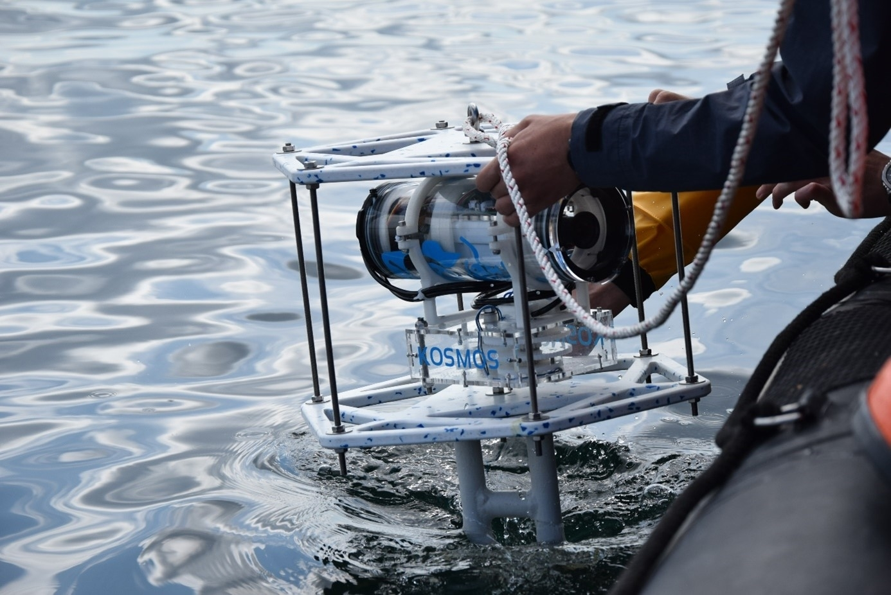

**BenthOS** (*Interface Homme-Machine*) est l'application de bureau associée au **système KOSMOS** — un enregistreur vidéo sous-marin autonome développé à l'IMT Atlantique. Après un déploiement sur le terrain, les opérateurs rapatrient un dossier de fichiers MP4 bruts et les traitent dans cette station pour qualifier les enregistrements, annoter les événements biologiques, renseigner les métadonnées et produire les livrables.

Toutes les données de campagne sont persistées dans des fichiers sidecar `_temp.json` associés à chaque vidéo. Les fichiers JSON bruts produits par l'appareil ne sont **jamais modifiés**.

---

## Captures d'écran

### Accueil
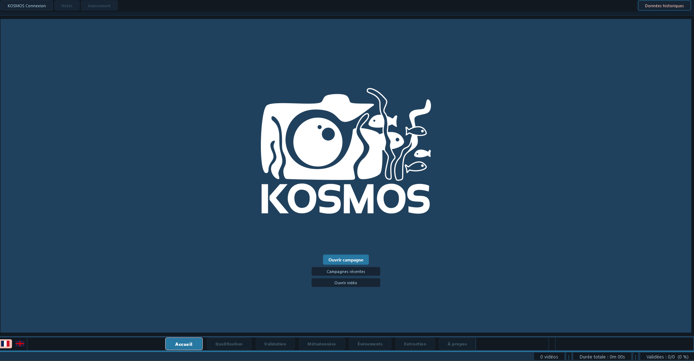

La page d'accueil permet d'ouvrir une campagne existante ou d'en créer une nouvelle en sélectionnant le dossier des vidéos brutes, le répertoire de sortie et le répertoire de travail. Les campagnes récentes sont accessibles en un clic et un mode vidéo unique est disponible pour les revues ponctuelles.

---

### Qualification
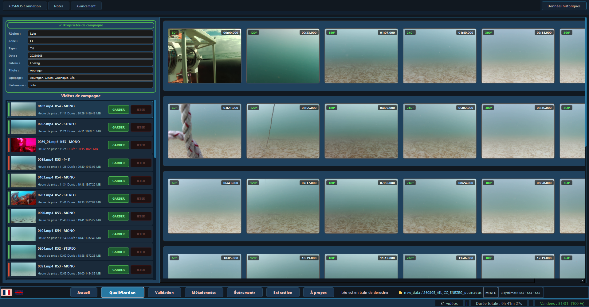

La page de qualification est la première étape de traitement. Toutes les vidéos de la campagne sont affichées dans le panneau gauche avec leur nom, durée et taille. L'opérateur visionne chaque vidéo dans le lecteur intégré et décide de la **Garder** ou de la **Jeter**. Les vidéos rejetées sont déplacées dans une corbeille et peuvent être restaurées à tout moment. `Ctrl+Z` annule la dernière action.

---

### Validation
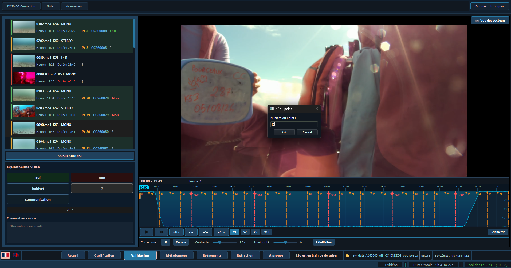

La page de validation est une seconde passe de revue sur les vidéos qualifiées. Pour chaque vidéo, l'opérateur peut définir son statut d'**exploitabilité** (exploitable / partiellement exploitable / non exploitable) et confirmer la configuration caméra stéréo/mono. La saisie de l'**ardoise** est obligatoire avant qu'une vidéo puisse être considérée comme validée. Tous les choix sont persistés dans le fichier `_temp.json` associé. `Ctrl+Z` annule le dernier changement d'exploitabilité.

**Clic droit sur « SAISIR ARDOISE »** ouvre un menu contextuel avec trois options de détection d'ardoise par ArUco :
- **Détecter Ardoise** — détecte le QR code de l'ardoise sur la vidéo actuellement chargée (désactivé pour les segments séquentiels `_01`, `_02`…).
- **Détecter ardoise — toutes les vidéos** — lance la détection sur toutes les vidéos de la campagne.
- **Détecter toutes les ardoises sans codestations** — lance la détection uniquement sur les vidéos qui n'ont pas encore de codestation renseignée.

---

### Analyse Habitat


La page d'analyse habitat est l'étape de codage biologique. Seules les vidéos dont le statut d'exploitabilité est **oui** ou **habitat** sur la page Validation apparaissent ici, triées par code station et colorées selon leur statut.

**Liste des stations (panneau gauche)** — chaque station est listée avec son code. Une fois un masque de saisie XLSX généré pour une station, un indicateur **✓ Masque généré** apparaît en italique à côté de son nom. La hauteur du panneau est ajustable via un séparateur vertical.

**Visionneuse de secteurs (centre)** — six captures extraites de la vidéo sont affichées côte à côte, une par secteur d'analyse. Cliquer sur un secteur le sélectionne et charge ses données dans le formulaire à droite. Chaque miniature affiche un badge avec le nombre de champs renseignés pour ce secteur.

**Formulaire habitat (panneau droit)** — un formulaire défilant piloté par `_SCHEMA` avec des sections dépliables (cliquer sur le triangle pour développer/réduire). Les sections comprennent :
- **Topo et complexité** — scores de topographie et complexité (1–5).
- **Recouvrement visible** — pourcentage de couverture par type de substrat (sable, vase, roches, bioconstruit, herbier sur substrat non visible, etc.). Le total est calculé automatiquement.
- **Herbier ou Algues sur substrat visible** — présence d'herbiers ou d'algues sur le substrat visible.
- **Recouvrement Herbier** — détail de la couverture d'herbier (total, court, grand, dense, semi-dense, clairsemé, matière morte).
- **Recouvrement Algues** — détail par groupe d'espèces ; total calculé automatiquement.
- **Présence Algues** — sélecteur en cascade listant 16 espèces de macroalgues (Laminaria, Cystoseira, Ulva, Corallines, etc.).
- **Invertébrés remarquables** — sélecteur en cascade avec comptage individuel pour 14 taxons d'invertébrés (huîtres, moules, éponges, oursins, etc.).
- **Anthropisation** — état de santé des herbiers/algues, présence d'engins de pêche, présence de macrodéchets.

**Canvas image** — le cadre du secteur est affiché dans un canvas zoomable et déplaçable. La molette de la souris zoome vers la position du curseur. Clic molette ou glisser pour se déplacer.

**Panneau Analyse vidéo** — un panneau dépliable compact sous la liste des stations regroupe les métadonnées d'annotation : annotateur poissons, annotateur habitat, date d'annotation, version du logiciel et commentaires libres. Les champs sont sauvegardés automatiquement dans `habitat.json`.

**Export masque de saisie XLSX** — cliquer sur **Générer masque saisie (XLSX)** génère un fichier Excel coloré (`.xlsx`) directement dans le dossier des vidéos brutes de la station, au format du modèle de référence *Masque saisie CC 2022* :
- En-tête en bleu-gris (`#93CDDD`), gras.
- Lignes de section en bleu clair (`#DEE6EF`), gras.
- Une ligne par champ, colonnes : *Nom du point* | *Couches* | *Caractéristiques* | *1* | *2* | *3* | *4* | *5* | *6* | *Commentaire*.
- Code station fusionné sur toutes ses lignes en colonne A.
- Si un fichier existe déjà, une boîte de dialogue de confirmation apparaît avant l'écrasement.

**Clic droit sur le bouton d'export** → *Générer tous les masques de saisie* — génère en lot un XLSX par station. Une boîte de dialogue avec deux barres de progression affiche la progression par station (lignes écrites) et la progression globale de la campagne simultanément.

Toutes les données habitat sont persistées dans un fichier sidecar `habitat.json` écrit à côté de la vidéo brute.

```json
{
  "meta": {
    "codestation": "CC220001",
    "fish_annotator": "...",
    "habitat_annotator": "...",
    "annotation_date": "...",
    "logiciel": "BenthOS"
  },
  "sectors": [
    {
      "index": 1,
      "topographie": 3,
      "complexite": 2,
      "recouvrement_visible": { "sable": 40, "vase": 10, ... },
      "recouvrement_herbier": { "total_herbier": 30, ... },
      "recouvrement_algues":  { "alg_brunes_nid": 5, ... },
      "presence_algues": ["laminaria_sp", "corallines"],
      "invertebres": { "oursin": 3, "crabe": 1 },
      "etat_sante": 2,
      "engins_peche": 0,
      "macrochets": 0
    },
    ...
  ]
}
```

`habitat.json` est créé automatiquement lorsque le statut d'exploitabilité d'une vidéo est défini sur *oui* ou *habitat* sur la page Validation.

---

### Annotation d'événements
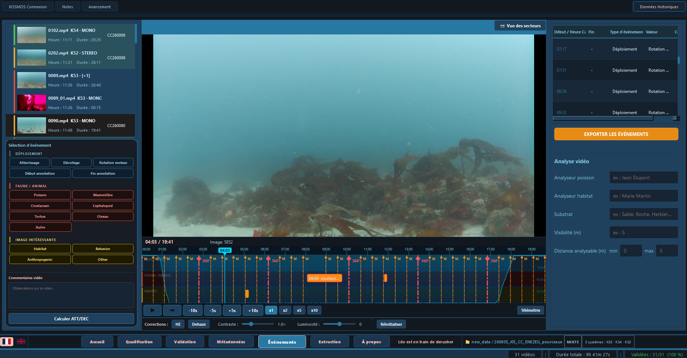

La page d'annotation d'événements permet à l'opérateur de poser des observations biologiques horodatées directement sur la timeline vidéo. Les types d'événements supportés comprennent les poissons, oiseaux, tortues et événements moteur, chacun avec un sous-type configurable, un comptage et un commentaire libre. Un signal sonore retentit à chaque capture. Les événements sont affichés dans une vue arborescente à droite et peuvent être déplacés sur la timeline avec `Ctrl+glisser`. `Ctrl+Z` annule le dernier placement, suppression ou déplacement. La liste complète peut être exportée en CSV.

**Détection automatique des rotations moteur** — Le clic droit sur le bouton « Rotation moteur » ouvre un menu contextuel avec :
- **Détecter automatiquement (entre ATT/DÉC)** — disponible uniquement après le placement des marqueurs Atterrissage (*ATT*) et Décollage (*DÉC*). L'algorithme utilise la corrélation de phase OpenCV pour identifier les panoramiques horizontaux entre les deux bornes, s'exécute en tâche de fond et affiche une boîte de progression. Les rotations détectées sont ajoutées au même pool que celles placées manuellement.
- **Détecter toutes les vidéos (avec ATT/DÉC posés)** — détection en lot sur toutes les vidéos de la campagne ayant les deux marqueurs ATT et DÉC. Une boîte de dialogue affiche deux barres de progression en parallèle.

**Timeline par zones** — La timeline est divisée en trois zones horizontales (Déploiement, Faune/Animal, Images Intéressantes). Les marqueurs de rotation moteur ne sont sélectionnables, déplaçables et survolables qu'à l'intérieur de la zone Déploiement.

**Priorité des marqueurs en superposition** — Lorsqu'un marqueur Atterrissage/Décollage (`timecode_marker`) et une rotation moteur partagent la même position, `Ctrl+clic` sélectionne toujours le `timecode_marker`.

### Export d'événements
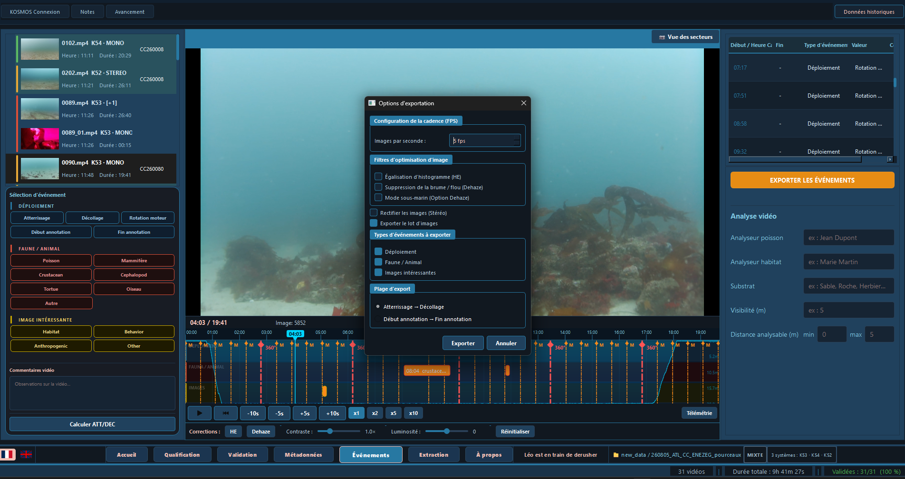

La boîte de dialogue d'export d'événements permet d'exporter les événements annotés pour une ou toutes les vidéos de la campagne. La sortie est un fichier CSV contenant les timecodes, types d'événements, valeurs et commentaires, prêt à être importé dans des outils d'analyse.

---

### Édition des métadonnées
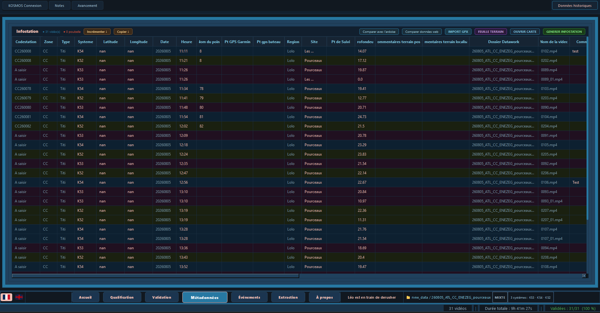

La page des métadonnées expose tous les champs d'observation structurés définis dans `template.json` : zone, date, nom du navire, pilote, coordonnées GPS, profondeur, visibilité, état de la mer, etc. Les champs de niveau campagne (zone, date, équipage) sont en lecture seule et partagés entre toutes les vidéos ; les champs de niveau vidéo sont éditables par vidéo. Un bouton de récupération météo interroge Open-Meteo et pré-remplit les champs correspondants. Une vue carte GPS permet de vérifier ou corriger la position de déploiement.

---

### Extraction
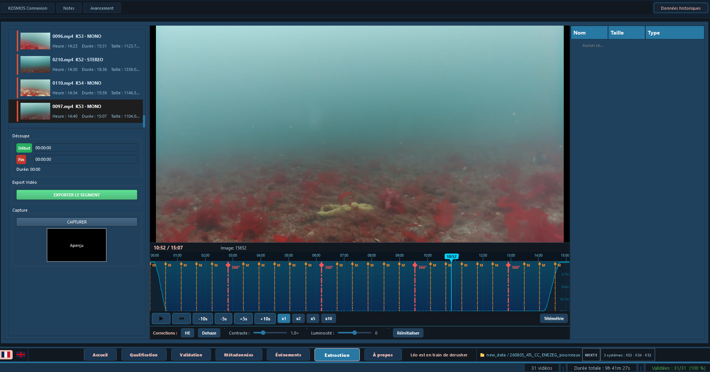

La page d'extraction sert à produire les livrables de chaque vidéo. L'opérateur pose des marqueurs entrée/sortie sur la timeline pour découper un segment, ou capture des images fixes individuelles. Plusieurs options d'amélioration d'image sont disponibles : égalisation d'histogramme, déflou CLAHE, correction colorimétrique sous-marine et rectification stéréo pour les séquences double caméra. Tous les segments et images extraits sont listés dans un arbre de livrables avec miniatures et peuvent être réexportés à tout moment.

---

### Transfert SFTP
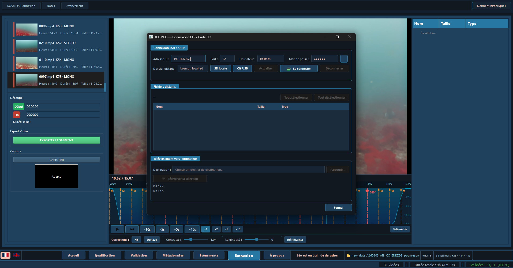

La boîte de dialogue SFTP se connecte directement à l'appareil KOSMOS via SSH/SFTP (avec paramiko) sans nécessiter le montage de la carte SD. L'opérateur saisit l'adresse IP et les identifiants de l'appareil, parcourt le système de fichiers distant et transfère les vidéos brutes et les fichiers JSON de télémétrie vers le dossier de campagne local en une opération.

---

### Télémétrie
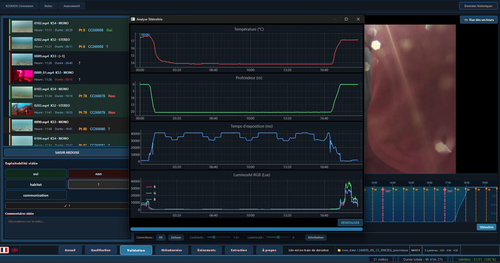

La boîte de dialogue de télémétrie affiche les données brutes des capteurs enregistrées par l'appareil KOSMOS lors d'un déploiement. Elle lit le fichier CSV de télémétrie associé à la vidéo courante et présente les séries temporelles (rotations moteur, profondeur, cap, etc.) pour permettre à l'opérateur de recouper les conditions de déploiement avec les images vidéo.

---

### Planificateur de déploiement
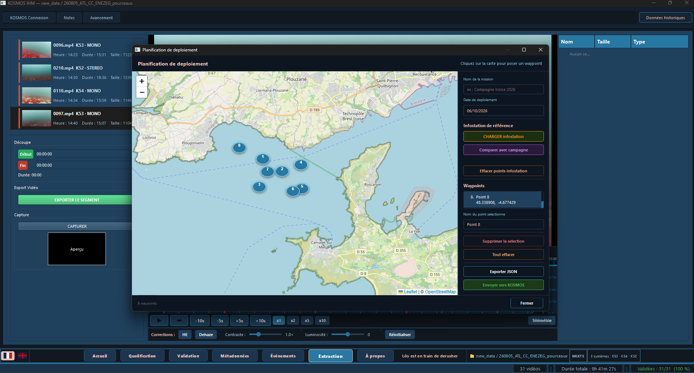

Le planificateur de déploiement est une carte Leaflet interactive (embarquée via Qt WebEngine) qui permet à l'équipe de planifier la couverture spatiale d'une mission avant le terrain. Les points de déploiement peuvent être placés, déplacés et annotés directement sur la carte. Les stations planifiées peuvent être exportées sous forme de liste de waypoints.

---

### Données historiques
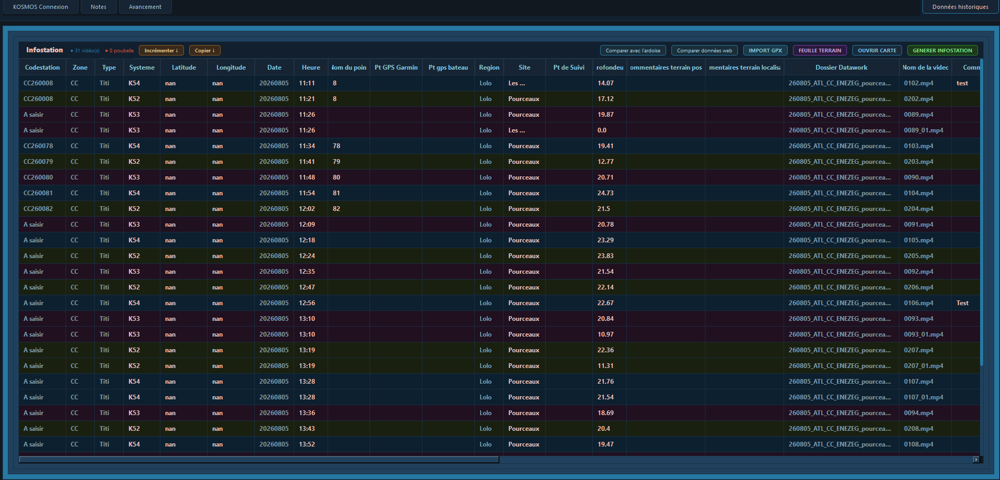

La boîte de dialogue de données historiques permet de charger et de parcourir les enregistrements d'observations de campagnes précédentes. Cela permet de croiser les déploiements passés sur le même site, de comparer les comptages d'événements dans le temps et d'éviter de dupliquer des annotations déjà enregistrées lors de missions antérieures.

---

### Tableau de bord de progression
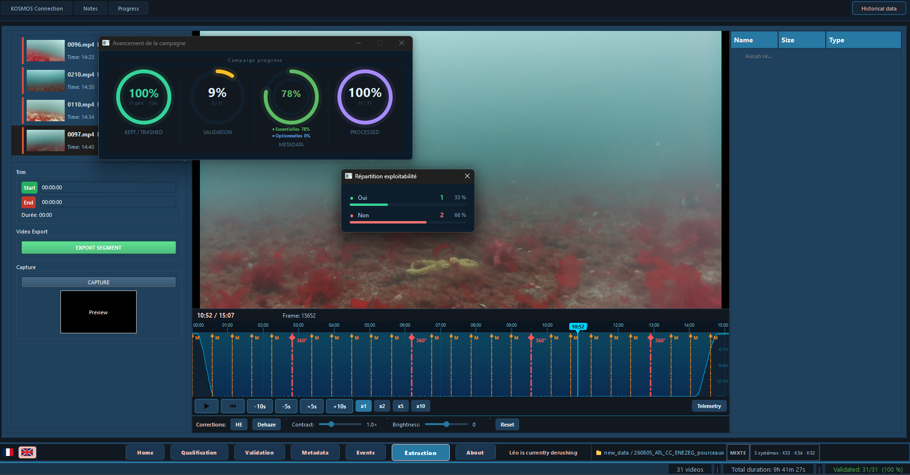

Le tableau de bord de progression offre une vue d'ensemble en temps réel de l'état de traitement de la campagne. Il indique combien de vidéos ont été qualifiées, validées, annotées et ont leurs métadonnées renseignées, afin que l'opérateur puisse voir d'un coup d'œil ce qui reste à faire avant de générer le rapport PDF final.

---

## Fonctionnalités

| Page | Description |
|---|---|
| **Qualification** | Revoir tous les enregistrements sur une carte GPS interactive. Garder ou rejeter chaque vidéo en un clic. |
| **Validation** | Seconde passe de revue. Basculer l'exploitabilité et la configuration stéréo/mono par vidéo. Clic droit sur « SAISIR ARDOISE » pour lancer la détection ArUco sur la vidéo courante, toutes les vidéos, ou uniquement celles sans codestation. |
| **Annotation d'événements** | Marquer des événements horodatés sur la timeline vidéo : poissons, oiseaux, tortues, événements moteur — avec signaux sonores. Interaction par zones et détection automatique des rotations moteur (vidéo unique ou lot complet). |
| **Édition des métadonnées** | Éditer des champs structurés pilotés par un schéma `template.json` configurable. Inclut la récupération météo et une vue carte GPS. |
| **Analyse Habitat** | Formulaire de codage biologique secteur par secteur pour les stations exploitables. Sections dépliables, visionneuse de secteurs zoomable, sélecteurs en cascade pour les algues et invertébrés. Exporte un masque de saisie XLSX coloré au format *Masque saisie CC 2022*. Données persistées en `habitat.json`. |
| **Extraction** | Découper des segments vidéo et capturer des images fixes avec déflou CLAHE, égalisation d'histogramme et rectification stéréo. |
| **Rapport PDF** | Générer un rapport de campagne avec statistiques, nuage de points GPS et fiches par vidéo. |
| **Transfert SFTP** | Rapatrier les fichiers depuis la carte SD du KOSMOS directement via SSH/SFTP sans monter le lecteur. |
| **Interface bilingue** | Basculement français / anglais à l'exécution. |

---

## Prérequis

- **Système d'exploitation :** Windows 10 / 11
- **Python :** 3.12

| Package | Version | Rôle |
|---|---|---|
| `PyQt6` | 6.11.0 | Framework GUI |
| `PyQt6-WebEngine` | 6.11.0 | Chromium embarqué pour les cartes Leaflet |
| `opencv-python` | 4.13.0 | Lecture vidéo, extraction d'images, rectification stéréo |
| `numpy` | 2.4.4 | Traitement d'image vectorisé |
| `matplotlib` | 3.10.9 | Génération de rapport PDF |
| `pandas` | 3.0.2 | Lecture des CSV de télémétrie |
| `paramiko` | 4.0.0 | Transfert SFTP depuis le matériel KOSMOS |
| `requests` | 2.33.1 | API météo (Open-Meteo) |
| `folium` | 0.20.0 | Génération de cartes Leaflet interactives |
| `openpyxl` | 3.1.5 | Export masque de saisie XLSX |
| `pywin32` | 312 | Intégration shell Windows |

---

## Installation

### Option A — Conda (recommandée)

```bash
conda env create -f environment.yml
conda activate kosmos-ihm
```

### Option B — pip / venv

```bash
python -m venv venv
venv\Scripts\activate
pip install -r requirements.txt
```

> **Note :** Les vues cartographiques nécessitent `PyQt6-WebEngine`. S'assurer qu'il est installé avec `PyQt6`.

---

## Lancement

```bash
python main.py
```

Au premier lancement, cliquer sur **Ouvrir une campagne** et sélectionner :

1. **Répertoire des vidéos brutes** — le dossier de l'unité KOSMOS (ex. `260730_K54/`).
2. **Répertoire de travail** — BenthOS créera automatiquement un dossier `BenthOS_sorties/` à côté.

Les journaux de plantage sont écrits dans `kosmos_crash.log` à côté de `main.py`.

---

## Générer un exécutable autonome

Un fichier spec PyInstaller est fourni pour empaqueter l'application dans un dossier Windows autonome :

```bash
py -m PyInstaller KOSMOS_IHM.spec
```

Sortie : `dist\KOSMOS_IHM\KOSMOS_IHM.exe` — embarque Qt WebEngine, OpenCV et tous les fichiers de données. Aucune installation Python requise sur la machine cible.

---

## Architecture du code

```
BenthOS/
├── main.py                   # Point d'entrée
├── ihm2.ui                   # Layout Qt Designer (chargé à l'exécution)
├── template.json             # Schéma des métadonnées (pilote l'éditeur Métadonnées)
├── requirements.txt
├── environment.yml           # Spécification d'environnement Conda (Python 3.12)
├── KOSMOS_IHM.spec           # Spécification de build PyInstaller
│
├── controllers/              # Logique métier, un contrôleur par page
│   ├── app_controller.py     # Orchestrateur de haut niveau
│   ├── accueil_controller.py
│   ├── qualif_controller.py
│   ├── validation_controller.py
│   ├── evenements_controller.py
│   ├── metadonnees_controller.py
│   ├── extraction_controller.py
│   ├── analyse_habitat_controller.py  # Codage habitat + export XLSX
│   └── apropos_controller.py
│
├── models/                   # Modèles Qt (sans widgets)
├── views/                    # Widgets de page, boîtes de dialogue, widgets réutilisables
├── services/                 # I/O backend (SFTP, miniatures, PDF, météo…)
├── assets/                   # HTML/JS Leaflet, signaux sonores WAV
└── img/                      # Icônes de l'application
```

---

## Architecture des données

### Entrée — structure du dossier de campagne

Une campagne KOSMOS est organisée comme suit. Le dossier racine de la campagne contient un sous-dossier par unité KOSMOS déployée. Chaque dossier d'unité contient un sous-dossier par station (point de déploiement), et chaque dossier de station contient les fichiers enregistrés pour ce déploiement :

```
260805_ATL_CC_ENEZEG_pourceaux/       ← dossier campagne
├── 260730_K54/                        ← unité KOSMOS
│   ├── 0102/                          ← station
│   │   ├── 0102.mp4                   # vidéo brute (jamais modifiée)
│   │   ├── 0102.json                  # métadonnées appareil (jamais modifié)
│   │   ├── 0102.csv                   # séries temporelles GPS / capteurs (jamais modifié)
│   │   ├── 0102.txt                   # journal appareil (jamais modifié)
│   │   ├── 0102_temp.json             # ← annotations BenthOS (modifiable)
│   │   ├── 0102_habitat.json          # ← données de codage habitat (modifiable)
│   │   └── systemEvent.csv            # journal d'événements système (jamais modifié)
│   ├── 0103/
│   └── ...
├── 260805_K52/
└── 260805_K53/
```

| Fichier | Source | Description |
|---|---|---|
| `<stem>.mp4` | Appareil KOSMOS | Vidéo brute. Jamais modifiée par BenthOS. |
| `<stem>.json` | Appareil KOSMOS | Métadonnées appareil : caméra, firmware, config système. Lecture seule. |
| `<stem>.csv` | Appareil KOSMOS | Télémétrie série temporelle : GPS, profondeur, cap, rotations moteur. Lecture seule. |
| `<stem>.txt` | Appareil KOSMOS | Journal d'événements appareil. Lecture seule. |
| `systemEvent.csv` | Appareil KOSMOS | Événements système (démarrage/arrêt moteur, etc.). Lecture seule. |
| `<stem>_temp.json` | BenthOS | Sidecar d'annotation principal. Contient qualification, validation, événements, livrables d'extraction. |
| `<stem>_habitat.json` | BenthOS | Sidecar de codage habitat. Créé automatiquement quand l'exploitabilité est définie sur *oui* ou *habitat*. Stocke `meta` (annotateurs, date) + tableau `sectors`. |

La structure `_temp.json` reprend `template.json` et stocke :

```json
{
  "survey":            {},   // Champs de niveau campagne : zone, date, navire, équipage
  "video_observation": {}    // Champs de niveau vidéo : GPS, profondeur, visibilité,
                             // statut de qualification, exploitabilité, stéréo/mono,
                             // événements biologiques, livrables d'extraction
}
```

### Sortie — BenthOS_sorties

Lors de l'ouverture d'une campagne, BenthOS crée automatiquement un dossier `BenthOS_sorties/` à côté du dossier de campagne. Tous les livrables y sont écrits.

```
BenthOS_sorties/
├── 261006_infoStation.csv                  ← généré via le bouton « Générer InfoStation »
└── 202608051148_Lolo_CC260080/             ← un dossier par vidéo, renommé à l'export
    ├── IMG/                                 # lot d'images extraites
    ├── 202608051148_Lolo_CC260080.json      # _temp.json renommé selon le code station final
    ├── 202608051148_Lolo_CC260080.lnk       # Raccourci Windows → .mp4 brut
    └── Annotation_VIAME.csv                 # fichier d'annotation prêt pour VIAME
```

Le dossier par vidéo (et son JSON / raccourci) est nommé selon la convention suivante, construite automatiquement à partir des métadonnées renseignées sur la page Métadonnées :

```
YYYYMMDDhhmm _ REGION _ ZONEyyNNNN
└─────┬──────┘   └─┬─┘   └───┬───┘
      │             │         └─ Code station :
      │             │              ZONE   = champ zone (ex. CC, ATL…)
      │             │              yy     = 2 chiffres de l'année du survey
      │             │              NNNN   = numéro de station sur 4 chiffres (ardoise / point_name)
      │             └─ Champ région (ex. ATL, MED…)
      └─ Date du survey (AAAAMMJJ) + heure de déploiement HHmm
           (extraite du nom du fichier vidéo, ou de video_observation.time)
```

**Exemple :** `202608051148_ATL_CC260080`
- `20260805` — date du survey (5 août 2026)
- `1148` — heure de déploiement (11h48)
- `ATL` — région
- `CC` — zone, `26` — année 2026, `0080` — station numéro 80

Si les métadonnées sont incomplètes (pas de date, région ou zone), BenthOS utilise le nom de fichier vidéo original comme nom de dossier.

| Sortie | Format | Généré par |
|---|---|---|
| `YYMMDD_infoStation.csv` | CSV | Bouton « Générer InfoStation » sur la page Métadonnées — une ligne par vidéo |
| `<renommé>/IMG/` | JPG | Page Extraction — lot d'images avec CLAHE / correction couleur optionnels |
| `<renommé>.json` | JSON | Export — le `_temp.json` copié et renommé selon le code station final |
| `<renommé>.lnk` | Raccourci Windows | Export — pointe vers le `.mp4` brut sur le lecteur d'origine |
| `Annotation_VIAME.csv` | CSV | Export — événements pré-formatés pour [VIAME](https://github.com/VIAME/VIAME) |

---

## Raccourcis clavier

| Raccourci | Page | Action |
|---|---|---|
| `Ctrl+Z` | Qualification | Annuler le dernier Garder / Jeter |
| `Ctrl+Z` | Validation | Annuler le dernier changement d'exploitabilité |
| `Ctrl+Z` | Événements | Annuler le dernier placement, suppression ou déplacement d'événement |
| `Ctrl+glisser` | Événements — timeline | Déplacer un événement (les rotations moteur ne répondent que dans la zone Déploiement) |
| `Espace` | Lecteur vidéo | Lecture / Pause |
| `Suppr` | Événements — arborescence | Supprimer l'événement sélectionné |

---

## Auteurs

Développé à l'**IMT Atlantique** — Léo Bultel
